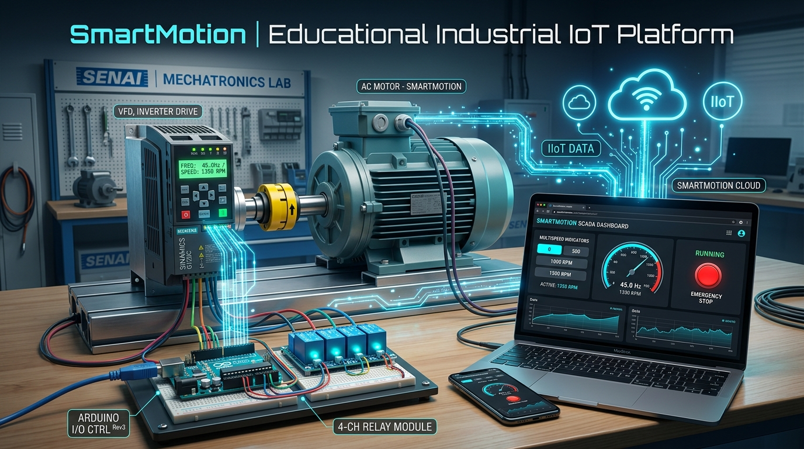
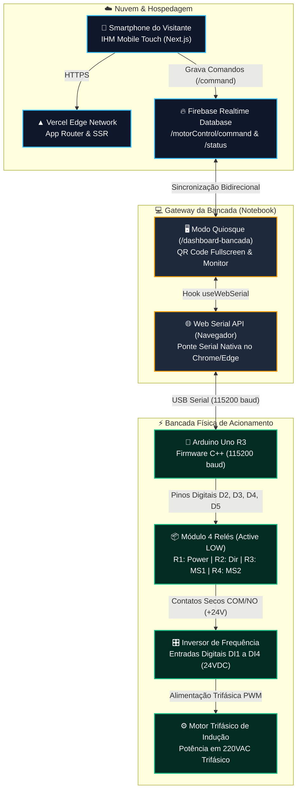
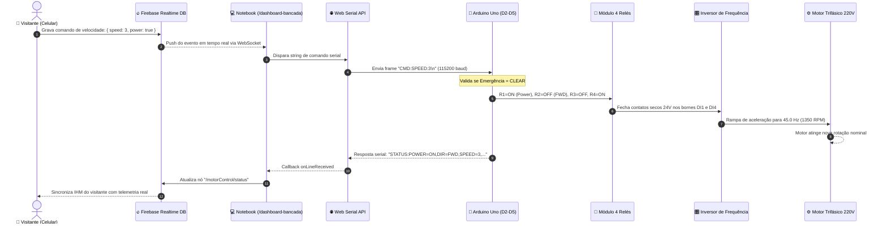
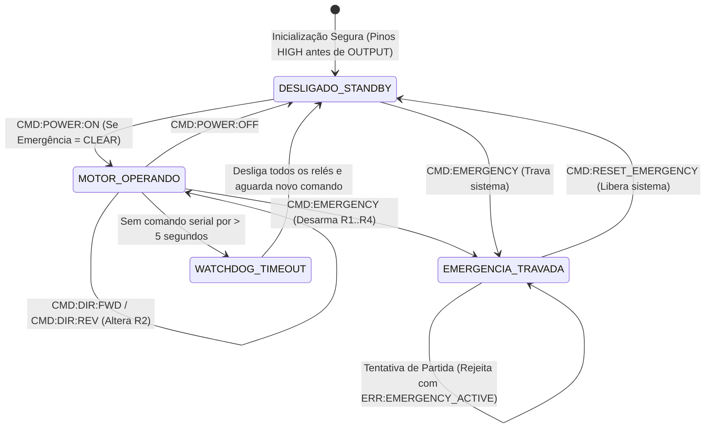

<div align="center">



### **Plataforma Educacional Integrada de Controle Multivelocidade de Motor Trifásico, Inversor de Frequência e IoT Industrial**
*Curso de Aprendizagem Industrial de Eletrônico de Manutenção Industrial — SENAI Timbó | Mundo SENAI*

[](https://nextjs.org/)
[](https://react.dev/)
[](https://www.typescriptlang.org/)
[](https://tailwindcss.com/)
[](https://firebase.google.com/)
[](https://www.arduino.cc/)
[](https://developer.mozilla.org/en-US/docs/Web/API/Web_Serial_API)
[](https://vercel.com/)
[](LICENSE)
[](https://sc.senai.br/)

<p align="center">
  <a href="#-sobre-o-projeto">Sobre</a> •
  <a href="#-principais-recursos">Recursos</a> •
  <a href="#-arquitetura-do-sistema">Arquitetura</a> •
  <a href="#-fluxo-de-execução-e-sequência">Fluxo de Sequência</a> •
  <a href="#-diagrama-de-estados--segurança-failsafe">Diagrama de Estados</a> •
  <a href="#-esquema-elétrico--hardware">Esquema Elétrico</a> •
  <a href="#-tabela-verdade-do-controle-multispeed">Tabela Multispeed</a> •
  <a href="#-protocolo-de-comunicação-serial">Protocolo Serial</a> •
  <a href="#-telas-e-módulos-do-sistema">Módulos da IHM</a> •
  <a href="#-guia-de-instalação-e-execução">Como Executar</a> •
  <a href="#-gravação-e-teste-do-firmware-arduino">Firmware Arduino</a> •
  <a href="#-roteiro-operacional-na-feira-mundo-senai">Operação na Feira</a> •
  <a href="#-segurança-industrial-nr-10--nr-12">Segurança (NR-10 & NR-12)</a> •
  <a href="#-estrutura-de-diretórios">Estrutura</a> •
  <a href="#-licença">Licença</a>
</p>

</div>

---

## 🎯 Sobre o Projeto

O **SmartMotion** (também denominado *SmartDrive Multispeed*) é uma plataforma educacional e interativa de **Indústria 4.0**, **Acionamentos Eletrônicos** e **IoT Industrial**, concebida especialmente para a feira **Mundo SENAI (SENAI Timbó)** pelos estudantes do curso de **Aprendizagem Industrial de Eletrônico de Manutenção Industrial**.

O objetivo central do projeto é aproximar a eletrônica digital em nuvem da força motriz pesada das fábricas modernas. Ele demonstra, de forma prática e visualmente envolvente, o **controle multivelocidade (*multispeed*) e a reversão de rotação de um motor de indução trifásico (MIT) em 220VAC** por meio de um **Inversor de Frequência Industrial**, operado remotamente a partir de qualquer smartphone via web.

### 💡 Grande Inovação: Arquitetura Serverless com Web Serial API Nativa
Diferente de soluções convencionais de laboratório que exigem a instalação de servidores locais (Node.js, scripts Python, daemons em segundo plano ou drivers virtuais com portas fixas), o **SmartMotion opera 100% no navegador**:
- A aplicação web hospedada na **Vercel** comunica-se diretamente com a porta USB do **Arduino Uno** através da **Web Serial API nativa** presente no Google Chrome e Microsoft Edge.
- O notebook posicionado na bancada física atua como um **Gateway Quiosque**: basta abrir a tela administrativa, clicar em **"Conectar Arduino (USB)"** e exibir o QR Code em tela cheia.
- Os visitantes da feira apontam a câmera do próprio celular para o QR Code, abrem a IHM Mobile e assumem o controle do motor instantaneamente, com sincronização em milissegundos via **Firebase Realtime Database**.

---

## 🌟 Principais Recursos

- 📱 **IHM Mobile do Visitante (Responsiva & Touch-First):** Controles ergonômicos para Ligar/Desligar, alternar Sentido de Giro (*Avanço / Retorno*), selecionar entre 4 patamares de Velocidade e acionar o *Cogumelo de Parada de Emergência*.
- 🖥️ **Painel Quiosque da Bancada (`/dashboard-bancada`):**
  - **Ponte Web Serial Nativa:** Conexão direta com a porta `COMx` do Arduino a 115.200 bps com reconexão suave e buffer de linha.
  - **QR Code Interativo:** Geração dinâmica do QR Code com atalho de edição de IP/URL e modo **Tela Cheia** para stands e feiras.
  - **Console & Telemetria em Tempo Real:** Terminal de logs seriais ao vivo, estados binários dos relés e tempos de resposta.
- ⚡ **Dashboard Didático Animado dos Relés:** Simulação gráfica dos 4 relés com LEDs de status, chaveamento em tempo real e visualização das linhas digitais DI1, DI2, DI3 e DI4 conectadas ao Inversor.
- 🔁 **Controle de Sentido de Giro (FWD / REV):** Alternância segura entre avanço e ré via contato digital no inversor.
- 📊 **Multispeed 4 Estágios:** Combinação digital de 2 relés para seleção das frequências pré-programadas do inversor (15 Hz, 30 Hz, 45 Hz e 60 Hz).
- 🛡️ **Segurança Failsafe Integrada (NR-10 & NR-12):**
  - **Watchdog de Comunicação:** Se o Arduino deixar de receber comandos por mais de 5 segundos, todos os relés são desenergizados automaticamente (*Safe-Off*).
  - **Prioridade Absoluta de Emergência:** O acionamento da emergência desarma imediatamente todas as saídas e trava o microcontrolador até a confirmação de um comando explícito de reset.
  - **Active LOW Seguro:** Configuração de pinos em nível alto antes da definição de saída (`OUTPUT`) no microcontrolador, eliminando pulsos espúrios (*glitches*) no boot.

---

## 🏗️ Arquitetura do Sistema

A topologia do ecossistema distribui responsabilidades entre a nuvem, o gateway local do navegador e o hardware de campo, garantindo isolamento galvânico e resposta em tempo real:



---

## 🔄 Fluxo de Execução e Sequência

A cadeia temporal abaixo ilustra o ciclo completo de um comando — desde o toque na tela do smartphone do visitante até a resposta mecânica do motor e o retorno de status em malha fechada:



---

## ⚡ Diagrama de Estados & Segurança Failsafe

O firmware em C++ no microcontrolador executa uma máquina de estados com transições rígidas orientadas à integridade humana e mecânica:



---

## 🔌 Esquema Elétrico & Hardware

O sistema adota o conceito de **isolamento galvânico em três barreiras de tensão**, garantindo que as altas correntes e tensões do inversor e da rede trifásica jamais atinjam os circuitos lógicos de baixa tensão:

```
[BARREIRA 1: USB / 5VDC]       [BARREIRA 2: 24VDC COMANDO]      [BARREIRA 3: 220VAC 3F POTÊNCIA]
========================       ===========================      ================================
Notebook (Porta USB)           Fonte Interna/Externa Inversor   Rede Trifásica 220V (L1, L2, L3)
         │                                   │                                 │
    [Cabo USB]                               │ (+24VDC)                        ▼
         ▼                                   ▼                            ┌─────────┐
 ┌───────────────┐                  ┌─────────────────┐                   │Disjuntor│
 │  Arduino Uno  │                  │  Barramento COM │                   │  Motor  │
 └───────┬───────┘                  │   dos 4 Relés   │                   └────┬────┘
         │ (D2, D3, D4, D5)         └────────┬────────┘                        │
         ▼                                   │ (NO 1..4)                       ▼
 ┌───────────────┐                  ┌────────┴────────┐                   ┌─────────┐
 │   Módulo de   │ ──(Isol. Óptico)─│ Entradas DI1..4 │ ──(Inversor PWM)──│ Inversor│
 │    4 Relés    │                  │  do Inversor    │                   │   VFD   │
 └───────────────┘                  └─────────────────┘                   └────┬────┘
                                                                               │ (U, V, W)
                                                                               ▼
                                                                          ┌─────────┐
                                                                          │  Motor  │
                                                                          │Trifásico│
                                                                          └─────────┘
```

### 1. Arduino Uno ➔ Módulo de 4 Relés
| Terminal Relé | Conexão Arduino | Lógica de Nível | Função |
| :--- | :--- | :--- | :--- |
| **VCC** | **5V do Arduino** | 5V Contínuo | Alimentação da bobina e circuito de acoplamento óptico |
| **GND** | **GND do Arduino** | 0V Referência | Referência comum com o microcontrolador |
| **IN 1** | **Pino Digital D2** | Active LOW (0V aciona) | **Relé 1:** Liga / Desliga (Power) |
| **IN 2** | **Pino Digital D3** | Active LOW (0V aciona) | **Relé 2:** Sentido de Rotação (Direção) |
| **IN 3** | **Pino Digital D4** | Active LOW (0V aciona) | **Relé 3:** Multispeed Bit 0 |
| **IN 4** | **Pino Digital D5** | Active LOW (0V aciona) | **Relé 4:** Multispeed Bit 1 |

### 2. Módulo de 4 Relés ➔ Bornes do Inversor de Frequência
| Relé | Borne Relé | Conexão Inversor | Descrição Funcional |
| :--- | :--- | :--- | :--- |
| **Geral** | **COM (Comum de todos)** | **Borne +24VDC do Inversor** | Barramento positivo comum das entradas digitais |
| **Relé 1** | **NO (Normalmente Aberto)** | **DI1 (Entrada Digital 1)** | Habilita rotação geral (*Gira / Para*) |
| **Relé 2** | **NO (Normalmente Aberto)** | **DI2 (Entrada Digital 2)** | Sentido de giro (*Aberto: Avanço FWD / Fechado: Retorno REV*) |
| **Relé 3** | **NO (Normalmente Aberto)** | **DI3 (Entrada Digital 3)** | Seleção de velocidade Multispeed Bit 0 |
| **Relé 4** | **NO (Normalmente Aberto)** | **DI4 (Entrada Digital 4)** | Seleção de velocidade Multispeed Bit 1 |
| **Referência** | — | **Borne 0V / GND do Inversor** | Referência de retorno da fonte de 24V do inversor |

---

## 🎛️ Tabela Verdade do Controle Multispeed

A lógica digital implementada com os Relés 3 e 4 mapeia diretamente os parâmetros de **Multivelocidade** configurados no inversor de frequência (ex: WEG CFW500 / CFW08 ou similar):

| Estágio de Velocidade | Relé 3 (DI3) | Relé 4 (DI4) | Frequência de Saída | Rotação Estimada (Motor 4 Polos) |
| :---: | :---: | :---: | :---: | :---: |
| **Velocidade 1 (Baixa)** | **OFF** (Aberto) | **OFF** (Aberto) | **15.0 Hz** | ~450 RPM |
| **Velocidade 2 (Média)** | **ON** (Fechado) | **OFF** (Aberto) | **30.0 Hz** | ~900 RPM |
| **Velocidade 3 (Alta)** | **OFF** (Aberto) | **ON** (Fechado) | **45.0 Hz** | ~1350 RPM |
| **Velocidade 4 (Máxima)** | **ON** (Fechado) | **ON** (Fechado) | **60.0 Hz** | ~1800 RPM |

> **Nota:** Quando o sistema está Desligado (`power: false`) ou a Emergência está Ativa, todos os relés permanecem desatracados (OFF), cortando o sinal no DI1 (*Gira/Para*).

---

## 📡 Protocolo de Comunicação Serial

A comunicação serial opera a **115.200 bps**, com comandos e telemetrias em formato ASCII delimitados por quebra de linha (`\n` ou `\r\n`):

### Comandos: Navegador (Web Serial) ➔ Arduino
| Comando | Descrição | Ação no Firmware | Resposta Serial |
| :--- | :--- | :--- | :--- |
| `CMD:POWER:ON` | Liga o motor | Atraca Relé 1 (se Emergência inativa) | `ACK:POWER_ON` |
| `CMD:POWER:OFF` | Desliga o motor | Desatraca todos os 4 relés | `ACK:POWER_OFF` |
| `CMD:DIR:FWD` | Sentido Horário / Avanço | Desatraca Relé 2 | `ACK:DIR_FWD` |
| `CMD:DIR:REV` | Sentido Anti-horário / Retorno | Atraca Relé 2 | `ACK:DIR_REV` |
| `CMD:SPEED:1` | Velocidade 1 (15 Hz) | R3=OFF, R4=OFF | `ACK:SPEED_SET` |
| `CMD:SPEED:2` | Velocidade 2 (30 Hz) | R3=ON, R4=OFF | `ACK:SPEED_SET` |
| `CMD:SPEED:3` | Velocidade 3 (45 Hz) | R3=OFF, R4=ON | `ACK:SPEED_SET` |
| `CMD:SPEED:4` | Velocidade 4 (60 Hz) | R3=ON, R4=ON | `ACK:SPEED_SET` |
| `CMD:EMERGENCY` | Parada de Emergência | Desarma todos os relés e trava operação | `ACK:EMERGENCY_ACTIVATED` |
| `CMD:RESET_EMERGENCY` | Liberação de Emergência | Limpa trava e retorna a standby desligado | `ACK:EMERGENCY_CLEARED` |

### Telemetria e Alertas: Arduino ➔ Navegador (Web Serial)
| Mensagem Serial | Tipo | Descrição |
| :--- | :---: | :--- |
| `STATUS:POWER=...,DIR=...,SPEED=...,R1=...,R2=...,R3=...,R4=...,EMERGENCY=...` | Telemetria | Pacote de estado completo transmitido a cada mudança |
| `ACK:<ACAO>` | Resposta | Confirmação de recebimento e execução do comando |
| `ERR:EMERGENCY_ACTIVE` | Erro | Comando rejeitado por motivo de bloqueio de emergência |
| `ERR:INVALID_SPEED` | Erro | Índice de velocidade fora da faixa permitida (1 a 4) |
| `ERR:UNKNOWN_CMD` | Erro | Sintaxe não reconhecida pelo parser |
| `WARN:SERIAL_TIMEOUT` | Alerta | Watchdog disparado: ausência de comandos por 5s desliga relés |
| `INFO:BOOT_OK` | Evento | Inicialização do microcontrolador concluída em modo seguro |

---

## 📱 Telas e Módulos do Sistema

| Módulo | Rota / Arquivo | Descrição e Finalidade |
| :--- | :--- | :--- |
| **IHM Mobile do Visitante** | [`/`](web_app/src/app/page.tsx) | Interface touch-first responsiva para celulares via QR Code. Apresenta controles de Liga/Desliga, Direção, Velocidade, Dashboard e Emergência. |
| **Dashboard Quiosque da Bancada** | [`/dashboard-bancada`](web_app/src/app/dashboard-bancada/page.tsx) | Painel administrativo do notebook da bancada: conexão Web Serial via USB, sincronização Firebase, gerador de QR Code com tela cheia e console de logs. |
| **Controle de Força e Direção** | [`PowerDirectionControl.tsx`](web_app/src/components/PowerDirectionControl.tsx) | Botoeira industrial digital de acionamento principal e alternância de sentido de rotação. |
| **Seletor de Velocidades** | [`SpeedControl.tsx`](web_app/src/components/SpeedControl.tsx) | 4 botões com indicação de Hertz, RPM aproximado e realce visual da velocidade ativa. |
| **Simulador Visual dos Relés** | [`RelayDashboard.tsx`](web_app/src/components/RelayDashboard.tsx) | Diagrama animado com indicação luminosa (verde/âmbar) dos 4 relés e roteamento para as DIs do inversor. |
| **Cogumelo de Emergência** | [`EmergencyButton.tsx`](web_app/src/components/EmergencyButton.tsx) | Botão industrial vermelho de emergência com trava lógica e processo de reset em duas etapas. |
| **Status de Conexão** | [`ConnectionStatus.tsx`](web_app/src/components/ConnectionStatus.tsx) | Badge com pulso dinâmico informando a conectividade em tempo real com o Firebase. |
| **Hook Web Serial** | [`useWebSerial.ts`](web_app/src/hooks/useWebSerial.ts) | Gerenciador nativo da porta serial no navegador, controle de streaming de leitura/escrita e reconexão. |
| **Hook de Controle Firebase** | [`useMotorControl.ts`](web_app/src/hooks/useMotorControl.ts) | Sincronizador de estados e despachante de comandos via Firebase Realtime Database. |

---

## 🚀 Guia de Instalação e Execução

### 📋 Pré-requisitos
- **Node.js:** Versão 18.17+ ou 20+ instalada na máquina.
- **Navegador Homologado:** Google Chrome, Microsoft Edge ou Opera (versão 89+) com suporte à Web Serial API.
- **Arduino IDE:** Para gravação do firmware no microcontrolador.
- **Hardware:**
  - 1x Arduino Uno R3 com cabo USB (Tipo A para Tipo B).
  - 1x Módulo de 4 Relés (5V, optoacoplado, Active LOW).
  - 1x Inversor de Frequência trifásico com entradas digitais programáveis.
  - 1x Motor de Indução Trifásico (MIT) 220VAC.
  - Cabos jumpers e fiação industrial de comando.

---

### 1. Clonar o Repositório
```bash
git clone https://github.com/gabrielpiske/SmartMotion.git
cd SmartMotion
```

---

### 2. Configurar o Frontend Web (`web_app`)
Acesse o diretório da aplicação web e instale as dependências:
```bash
cd web_app
npm install
```

---

### 3. Configurar as Variáveis de Ambiente do Firebase
Copie o modelo de variáveis de ambiente:
```bash
cp .env.local.example .env.local
```

Abra o arquivo `.env.local` e preencha com as credenciais do seu projeto no **Firebase Console** (aba *Configurações do Projeto > Seus aplicativos > Aplicativo da Web*):
```env
NEXT_PUBLIC_FIREBASE_API_KEY=AIzaSy...
NEXT_PUBLIC_FIREBASE_AUTH_DOMAIN=seu-projeto.firebaseapp.com
NEXT_PUBLIC_FIREBASE_DATABASE_URL=https://seu-projeto-default-rtdb.firebaseio.com
NEXT_PUBLIC_FIREBASE_PROJECT_ID=seu-projeto
NEXT_PUBLIC_FIREBASE_STORAGE_BUCKET=seu-projeto.firebasestorage.app
NEXT_PUBLIC_FIREBASE_MESSAGING_SENDER_ID=123456789
NEXT_PUBLIC_FIREBASE_APP_ID=1:123456789:web:abcdef
```

---

### 4. Configurar as Regras do Firebase Realtime Database
No console do Firebase, acesse **Realtime Database > Regras** e configure permissão para a rota `motorControl`:
```json
{
  "rules": {
    "motorControl": {
      ".read": true,
      ".write": true
    }
  }
}
```

---

### 5. Executar a Aplicação Web em Desenvolvimento
```bash
npm run dev
```
Acesse no navegador:
- **IHM do Visitante:** [http://localhost:3000](http://localhost:3000)
- **Dashboard da Bancada (Gateway):** [http://localhost:3000/dashboard-bancada](http://localhost:3000/dashboard-bancada)

---

### 6. Deploy na Vercel
Para colocar o sistema online para os visitantes da feira acessarem via internet móvel (4G/5G/Wi-Fi):
1. Suba o repositório para o seu GitHub.
2. Acesse [vercel.com](https://vercel.com/) e importe o repositório.
3. Configure o **Root Directory** como `web_app`.
4. Em **Environment Variables**, cadastre as mesmas variáveis configuradas no `.env.local`.
5. Clique em **Deploy**. A Vercel fornecerá uma URL pública (ex: `https://smartmotion.vercel.app`).

---

## ⚙️ Gravação e Teste do Firmware Arduino

1. Conecte o **Arduino Uno** na porta USB do computador.
2. Abra a **Arduino IDE**.
3. Abra o sketch em:  
   [`arduino_firmware/inversor_control.ino`](arduino_firmware/inversor_control.ino).
4. Em **Ferramentas > Placa**, selecione **Arduino Uno**.
5. Em **Ferramentas > Porta**, selecione a porta serial correspondente (**COMx** no Windows ou `/dev/ttyACM0` no Linux).
6. Clique no botão **Carregar (Upload)** (`Ctrl + U`).
7. *(Opcional - Teste via Monitor Serial):*
   - Abra o **Monitor Serial** (`Ctrl + Shift + M`).
   - Configure a velocidade para **115200 baud** e terminação para **Nova linha (`\n`)**.
   - Envie `CMD:POWER:ON` e observe o clique do Relé 1.
   - Envie `CMD:SPEED:3` e observe o chaveamento dos Relés 3 e 4.
   - Envie `CMD:EMERGENCY` e verifique se todos os relés desarmam instantaneamente.
   - Feche o Monitor Serial antes de abrir a aplicação web (a porta não pode estar ocupada).

---

## 🎪 Roteiro Operacional na Feira Mundo SENAI

Para uma demonstração estável e fluida aos visitantes:

```
┌─────────────────────────────────────────────────────────────────────────────┐
│                       CHECKLIST OPERACIONAL DE BANCADA                      │
├─────────────────────────────────────────────────────────────────────────────┤
│ 1. Alimente o Inversor de Frequência e confirme display em estado "rdy".    │
│ 2. Conecte o cabo USB do Arduino Uno na porta USB do notebook da bancada.   │
│ 3. Abra o Google Chrome no notebook e navegue até /dashboard-bancada.       │
│ 4. Clique no botão azul "Conectar Arduino (USB)" e selecione a porta COM.   │
│ 5. Verifique se o indicador muda para "Conectado (115200 baud)".            │
│ 6. Clique no botão "Tela Cheia" para destacar o QR Code no monitor.        │
│ 7. O visitante aponta a câmera do celular, abre a página e assume o comando!│
│ 8. Concluída a interação, aperte Parada de Emergência ou Desligar.          │
└─────────────────────────────────────────────────────────────────────────────┘
```

---

## 🛡️ Segurança Industrial (NR-10 & NR-12)

O **SmartMotion** foi estruturado com rigor técnico alinhado aos princípios das normas regulamentadoras de segurança do trabalho em máquinas e eletricidade:

1. **Princípio Failsafe (Falha Segura):**
   - O chaveamento no inversor depende do fechamento positivo dos contatos normalmente abertos (**NO**). Se a alimentação do Arduino for interrompida, se o cabo USB desconectar ou o computador desligar, as bobinas dos relés perdem sinal e abrem por ação de mola mecânica, parando o motor por inércia/rampa segura.
2. **Watchdog Serial Integrado (5 Segundos):**
   - Caso a rede sem fio do celular oscile ou o aplicativo feche enquanto o motor estiver girando, o temporizador interno do microcontrolador (`SERIAL_TIMEOUT_MS = 5000`) detecta ausência de comandos e desliga todos os relés automaticamente.
3. **Prioridade Absoluta da Emergência:**
   - O comando de emergência tem precedência hierárquica sobre qualquer outro comando. Uma vez acionada, a rotina trava internamente novas partidas até que uma liberação explícita em dois passos seja confirmada.
4. **Isolação Galvânica e Níveis Seguros de Tensão:**
   - Os estudantes e visitantes manipulam exclusivamente interfaces em tela touch (5VDC/Bateria). A bancada mantém isolamento óptico completo de 24VDC de comando e 220VAC de força, eliminando riscos de choque elétrico.

---

## 📁 Estrutura de Diretórios

```
SmartMotion/
├── .git/                                   # Controle de versão Git
├── docs/                                   # Documentação visual e assets
│   └── images/
│       └── smartmotion_banner.jpg          # Banner oficial e conceito 3D da plataforma
├── arduino_firmware/                       # Código-fonte embarcado do microcontrolador
│   └── inversor_control.ino                # Sketch C++ (115200 baud, Active LOW, Watchdog)
├── web_app/                                # Aplicação Full-Stack Next.js (App Router)
│   ├── public/                             # Arquivos estáticos e ícones
│   │   └── smartmotion_banner.jpg          # Cópia local do banner para exibição web
│   ├── src/
│   │   ├── app/
│   │   │   ├── dashboard-bancada/          # Painel Quiosque / Gateway USB
│   │   │   │   └── page.tsx                # Conexão Web Serial, QR Code e logs
│   │   │   ├── globals.css                 # Estilos globais e tokens Tailwind CSS 4
│   │   │   ├── layout.tsx                  # Layout raiz da aplicação
│   │   │   └── page.tsx                    # IHM Mobile touch-first do visitante
│   │   ├── components/
│   │   │   ├── ConnectionStatus.tsx        # Indicador de conexão com o Firebase
│   │   │   ├── EmergencyButton.tsx         # Botão industrial de parada de emergência
│   │   │   ├── PowerDirectionControl.tsx   # Liga/Desliga e Avanço/Retorno
│   │   │   ├── RelayDashboard.tsx          # Simulador animado dos 4 relés
│   │   │   └── SpeedControl.tsx            # Seletor de 4 velocidades multispeed
│   │   ├── hooks/
│   │   │   ├── useMotorControl.ts          # Sincronização em tempo real via Firebase
│   │   │   └── useWebSerial.ts             # Driver nativo da Web Serial API
│   │   ├── lib/
│   │   │   ├── firebase.ts                 # Inicialização do Firebase Realtime DB
│   │   │   └── types.ts                    # Tipagens TypeScript e constantes
│   │   └── types/                          # Declarações globais de tipos do navegador
│   ├── .env.local.example                  # Modelo de variáveis de ambiente
│   ├── package.json                        # Dependências e scripts do projeto web
│   └── tsconfig.json                       # Configurações do compilador TypeScript
├── AGENT.md                                # Diretrizes e regras técnicas para agentes de IA
├── CONTEXT.md                              # Contexto educacional e objetivos do projeto
├── LICENSE                                 # Licença de código aberto MIT
└── README.md                               # Documentação técnica e guia do ecossistema
```

---

## 🤝 Contribuições

Contribuições são bem-vindas para aprimorar a experiência didática e expandir os recursos da plataforma!

1. Realize um **Fork** do projeto.
2. Crie uma branch para sua funcionalidade:
   ```bash
   git checkout -b feature/minha-melhoria
   ```
3. Commit suas alterações:
   ```bash
   git commit -m "feat: adiciona nova funcionalidade na IHM"
   ```
4. Envie para a sua branch:
   ```bash
   git push origin feature/minha-melhoria
   ```
5. Abra um **Pull Request**.

---

## 📄 Licença

Este projeto é disponibilizado sob os termos da licença **MIT**. Para maiores detalhes, consulte o arquivo [LICENSE](LICENSE).

```
MIT License
Copyright (c) 2026 Gabriel Piske & Colaboradores SENAI
```

<div align="center">
  <sub>Desenvolvido com dedicação e excelência técnica para a formação dos futuros profissionais da indústria. ⚡🇧🇷</sub>
</div>